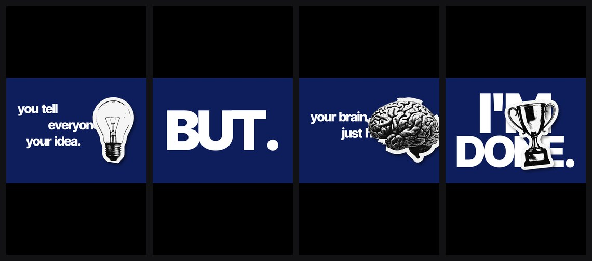

# Creative Studio

**Teach your AI to make short videos the way you do.**

Creative Studio is a local studio for creators. You feed it videos you learn from. It extracts what's inside: speech, frames, on-screen text, sound. Then your own AI (Claude, Codex, Cursor…) turns that into a library of methods. From there, you go from a brief to a script, a storyboard and a ready video. It ships with the **STACKER kit**: a complete short-video style you can use today.

**Русская версия — [README.ru.md](README.ru.md)**

> **Don't want to install anything?** Use the hosted version: **[Creative Studio online →](https://dolishx-creative-studio.pan-manager.chatgpt.site)**
> The same workflow in the browser, no setup.



## What it does

| | |
|---|---|
| **Learn from videos** | Drop in a video, a link or a note. Everything runs locally:<br>• speech is transcribed with word timings;<br>• frames are sampled at every scene cut and on a grid;<br>• on-screen text is read with OCR;<br>• the sound is mapped: speech, music, effects, loudness.<br>Your AI looks at the frames, writes a structured analysis and saves **method cards**, each linked to the exact second it came from. |
| **Make videos** | Write a brief: brand, goal, audience, platform, duration, voice. The studio picks matching methods and builds a context pack. Your AI writes the concept, hooks, script, voice-over and a storyboard that says why each scene works. You export a ZIP for your editor. |
| **Work through your AI** | A built-in **MCP server**: Claude Code, Claude Desktop, Codex, Cursor and other MCP clients can drive the studio in plain language. Ready-made **Claude skills** cover analysis, knowledge extraction, production and the STACKER style. |
| **STACKER kit** | A word-stack style with a guide, a renderer, **162 die-cut stickers** and generated sound design. Record your voice → `./studio stacker scenario.json` → MP4. [Open the kit →](stacker-kit/README.md) |
| **Review board** | One page to pick, reject and comment on everything your AI generated: stickers, test videos, sounds, style docs. Your AI reads your decisions back through MCP. |

## How it works

```
your videos / links / notes
        │  import
        ▼
 local processing (worker) ─ speech (mlx-whisper) · frames (ffmpeg) · OCR (Apple Vision) · sound map (AST + librosa)
        │  analysis pack
        ▼
 your AI via MCP ─ watches frames, writes analysis/1 ─▶ strict validator ─▶ method cards (with timecodes)
        │
        ▼
 brief ─▶ methods + context ─▶ script · hooks · voice-over · storyboard ─▶ export ZIP · STACKER render
```

The studio does the mechanics: extraction, storage, validation. Your AI does the thinking. Nothing goes in without passing the same validator, whether it comes from the UI, the CLI or MCP.

## Quick start

Requirements:
- macOS on Apple Silicon (local speech recognition uses MLX, OCR uses Apple Vision);
- [uv](https://docs.astral.sh/uv/);
- Node 20+;
- ~3 GB of free disk space for models.

```bash
git clone https://github.com/ydpsaa/creative-studio.git && cd creative-studio
uv venv --python 3.13 .venv
uv pip install --python .venv/bin/python -r requirements.lock.txt
(cd app/web && npm install && npm run build)
./studio start          # → http://127.0.0.1:8765
```

The speech model (~1.6 GB) downloads on the first transcription. The UI is in Russian; the CLI help and AI instructions work in any language.

Try the STACKER demo, no recording needed:
```bash
./studio stacker stacker-kit/examples/im_done.json
```

## Connect your AI

```bash
claude mcp add --scope user creative-studio -- "$(pwd)/studio" mcp
```

Then ask Claude: *"What's in my Creative Studio?"*

- Claude Desktop, Codex, Cursor and others: **[docs/CONNECT.md](docs/CONNECT.md)**.
- Full tool list: [docs/MCP.md](docs/MCP.md).

Things to ask:
- *"Learn from ~/Downloads/reel.mp4: I want to understand the hook and the music."*
- *"What methods do we have for a hook without showing my face?"*
- *"Make a stacker video from my recording ~/Movies/take3.mov."*
- *"Plan a 30-second video for my brand about …: brief, script, storyboard."*

## Principles

- **Evidence levels.** Every method is marked `author_explained` (with a quote), `observed` or `hypothesis`. Your own rules are `user_preference`, and only you can set them.
- **Honest coverage.** A transcript is not a visual analysis. A sample of frames is not every frame. The AI doesn't hear audio: the sound map is model estimates, and the studio says so.
- **Your data stays local.** Everything lives in `studio-data/` on your Mac. The API listens only on 127.0.0.1.
- **Other people's videos are a source of methods, not of footage.** Media is never downloaded behind logins. A closed link becomes "add the file yourself".

## Updates

This repository grows with the studio behind it. **Watch → Custom → Releases** to get notified. Changes are listed in [CHANGELOG.md](CHANGELOG.md).

## Follow

- 🌐 **Creative Studio online:** https://dolishx-creative-studio.pan-manager.chatgpt.site
- 📸 **Instagram:** [@dolishx](https://www.instagram.com/dolishx/)
<!-- more socials: add your links here, e.g.
- TikTok: https://tiktok.com/@…
- YouTube: https://youtube.com/@…
- Telegram: https://t.me/…
-->

Made by **Dolishx** ([@dolishx](https://www.instagram.com/dolishx/)). If you make a video with the STACKER kit, tag us. We'd love to see it.

## License

- **Code:** [MIT](LICENSE).
- **STACKER style guide and stickers:** [CC BY 4.0](stacker-kit/LICENSE). Credit: *"STACKER kit by Dolishx"*.
- **Fonts:** SIL OFL 1.1.
