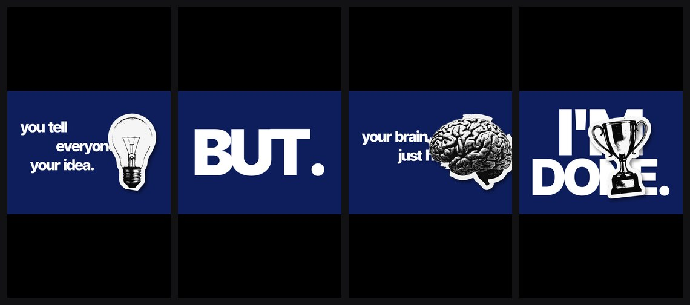

# Creative Studio

**Научите свой AI делать короткие ролики так, как делаете вы.**

Creative Studio — локальная студия для авторов роликов. Вы загружаете видео, у которых хотите учиться. Студия достаёт из них речь, кадры, текст на экране и звук. Ваш AI (Claude, Codex, Cursor…) превращает это в библиотеку методов. Дальше по брифу получаются сценарий, раскадровка и готовый ролик. В комплекте — **набор STACKER**, готовый стиль коротких видео, которым можно пользоваться сразу.

**English — [README.md](README.md)**

> **Не хотите ничего устанавливать?** Есть онлайн-версия: **[Creative Studio онлайн →](https://dolishx-creative-studio.pan-manager.chatgpt.site)** — тот же процесс в браузере, без установки.



## Что умеет

| | |
|---|---|
| **Учиться у роликов** | Студия принимает видео, ссылку или заметку. Всё обрабатывается локально:<br>• речь с таймингом слов;<br>• кадры на склейках и по сетке;<br>• текст на кадрах (OCR);<br>• звуковая карта: речь, музыка, эффекты, громкость.<br>Ваш AI смотрит кадры, пишет разбор и сохраняет **карточки методов**. У каждой карточки — ссылка на точную секунду источника. |
| **Делать ролики** | Вы задаёте бриф: бренд, цель, аудиторию, площадку, длительность и голос. Студия подбирает подходящие методы, и AI пишет концепцию, хуки, сценарий, озвучку и раскадровку. В раскадровке у каждой сцены есть основание. Результат — ZIP для монтажа. |
| **Работать через свой AI** | Встроенный **MCP-сервер**. Claude Code, Claude Desktop, Codex, Cursor и другие клиенты управляют студией обычными словами. В комплекте **навыки Claude**: разбор, карточки знаний, производство, стиль STACKER. |
| **Набор STACKER** | Стиль «стопка слов»: описание, рендер, **162 стикера с высечкой** и звуки заставки. Запишите голос, затем `./studio stacker сценарий.json` — получите MP4. [Открыть набор →](stacker-kit/README.ru.md) |
| **Ревью** | Одна страница, где можно выбрать, отклонить или прокомментировать всё, что сгенерировал AI: стикеры, тестовые видео, звуки и документы стиля. AI видит ваши решения через MCP. |

## Как это устроено

```
ваши видео / ссылки / заметки
        │  импорт
        ▼
 локальная обработка ─ речь (mlx-whisper) · кадры (ffmpeg) · OCR (Apple Vision) · звуковая карта (AST + librosa)
        │  пакет для разбора
        ▼
 ваш AI через MCP ─ смотрит кадры, пишет analysis/1 ─▶ строгая проверка ─▶ карточки методов с таймкодами
        │
        ▼
 бриф ─▶ методы + контекст ─▶ сценарий · хуки · озвучка · раскадровка ─▶ ZIP для монтажа · рендер STACKER
```

Студия делает механику: извлечение, хранение и проверку. Думает ваш AI. Ничего не попадает в базу без проверки — одинаково из интерфейса, CLI и MCP.

## Быстрый старт

Что нужно:
- macOS на Apple Silicon;
- [uv](https://docs.astral.sh/uv/);
- Node 20+;
- около 3 ГБ на диске под модели.

```bash
git clone https://github.com/ydpsaa/creative-studio.git && cd creative-studio
uv venv --python 3.13 .venv
uv pip install --python .venv/bin/python -r requirements.lock.txt
(cd app/web && npm install && npm run build)
./studio start          # → http://127.0.0.1:8765
```

Демо STACKER без записи голоса:
```bash
./studio stacker stacker-kit/examples/im_done.json
```

## Подключить свой AI

```bash
claude mcp add --scope user creative-studio -- "$(pwd)/studio" mcp
```

Затем спросите Claude: *«Что есть в моей Creative Studio?»*

Claude Desktop, Codex, Cursor и другие клиенты — в [docs/CONNECT.md](docs/CONNECT.md). Все инструменты описаны в [docs/MCP.md](docs/MCP.md).

## Принципы

- **Уровни доказательности.** У каждого метода есть пометка: автор объяснил (с цитатой), наблюдается или гипотеза. Ваши правила — отдельный уровень, его ставите только вы.
- **Честное покрытие.** Транскрипт — не визуальный разбор, а выборка кадров — не каждый кадр. Звук AI не слышит: звуковая карта — это оценки модели, и студия так и пишет.
- **Данные у вас.** Всё хранится в `studio-data/` на вашем Mac. API слушает только 127.0.0.1.
- **Чужие ролики — источник методов, а не материала.** Медиа в обход входа не скачиваются.

## Обновления

Репозиторий растёт вместе со студией. Чтобы получать уведомления о новых версиях, нажмите **Watch → Custom → Releases**. Изменения — в [CHANGELOG.md](CHANGELOG.md).

## Подписаться

- 🌐 **Creative Studio онлайн:** https://dolishx-creative-studio.pan-manager.chatgpt.site
- 📸 **Instagram:** [@dolishx](https://www.instagram.com/dolishx/)
<!-- другие соцсети: добавить ссылки сюда -->

Автор — **Dolishx** ([@dolishx](https://www.instagram.com/dolishx/)). Сделали ролик на STACKER — отметьте нас, нам интересно посмотреть.

## Лицензия

- Код — [MIT](LICENSE).
- Описание стиля STACKER и стикеры — [CC BY 4.0](stacker-kit/LICENSE).
- Шрифты — SIL OFL 1.1.
